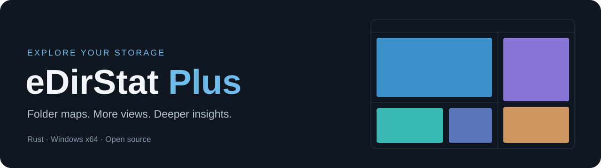

<p align="center"></p>

<p align="center">
  <a href="https://github.com/FASTDROPX/edirstat-plus/releases/latest"></a>
  
  <a href="LICENSE"></a>
</p>

<p align="center"><b>See where your space goes — from whole folders down to individual files.</b><br>Неофициальная доработка eDirStat: карта папок, новые режимы и подробная статистика.</p>

## v4 · A new workspace and automatic disk cache

**[Download Windows x64 →](https://github.com/FASTDROPX/edirstat-plus/releases/tag/v2.2.0-plus.4)** · **[UX guide / Инструкция →](docs/UX-PREVIEW.md)**

- New Home screen: disks, folders, saved snapshots, path entry and recent locations.
- Persistent sidebar for disk overview, charts, duplicates, cleanup, Docker and statistics. Home and Settings keep the current analysis available.
- Dedicated Settings with appearance, workspace, scanning/file operations and keyboard shortcuts. System, dark, light and high-contrast themes, plus three shell accent colors.
- A clear loading screen, MFT progress, stop action, copy-path action and compact navigation for narrow windows.
- **Disk cache is enabled by default:** a successful scan saves a snapshot, the last cached path reopens automatically at startup, and a fresh background scan verifies changes. Disable both cache reads and new writes in **Settings → Scanning and files → Disk cache**.
- Treemap layout, GPU rendering, zoom and folder transitions are unchanged from v3. **Ctrl + wheel** remains the zoom/exit gesture.

This release contains the **UX Preview** shell. It uses the separate **eDirStat UX Preview** settings/cache profile, so the v3 profile is not overwritten. New shell screens are currently in Russian; existing components retain their translations. The existing internal base version remains 2.2.0. The v3 download remains available in Releases.

Validation: Release build succeeded; the shell had 17 offscreen GPU captures covering 800/1280px, three themes, settings categories, loading and a sample workspace. The final small cache preference change was compiled without rerunning tests. Native picker flows and a real disk scan through the new shell were not manually exercised.

## v3 · GPU rendering, disk cache and smoother navigation

**[Windows x64 release →](https://github.com/FASTDROPX/edirstat-plus/releases/tag/v2.2.0-plus.3)** · **[CPU/GPU analysis and measurements →](docs/CPU-GPU-PERFORMANCE.md)**

- Tiny file gradients and one-pixel borders now render directly on the GPU using instanced rectangles. Unchanged tile buffers are reused.
- QHD synthetic benchmark: CPU preparation of tiny tiles dropped from **38.3 to 8.8 ms** (409,440 tiles) and **32.8 to 3.2 ms** (147,456 tiles). These are stage timings, not whole-application FPS claims.
- Persistent disk snapshots appear before a background fresh-MFT verification. This is not incremental USN verification.
- Smooth double-click folder focus, destination layout adapted to the viewport, reversible parent view, and **Ctrl + wheel** zoom/exit. Plain wheel does not exit a focused folder.
- Stable ordinary zoom, optional soft/color-only/no animations, folder headers protected from file tiles, dense minimum-size filling and mandatory file borders.
- The folder table uses the available width.

GPU output was checked offscreen on an RTX 5060 across 27 style/DPI images. The release build passed; the full test suite was not rerun for this release. Earlier feature checks are recorded in the development history.

## v2 · More detail, smoother navigation

**[v2 guide / Инструкция →](docs/V2.md)**

- Explicit **folder / file** modes; dense folders no longer collapse at the old 16 pixels²-per-file threshold.
- **Ctrl + wheel** zooms toward the cursor; drag to pan. Finer tiles fade in as you approach.
- **5 palettes** and **9 tile styles**, including vivid WizTree-inspired colors, pastel, glass, neon, and outlines.
- Map context menu: **Show in Explorer** and **Delete…**, using the existing deletion pipeline.
- Corrected MFT counters and scan-start timing; the status bar distinguishes indexing throughput from metadata reads.
- Adaptive partial tree publication, row fades, and a switch to disable live updates.
- Bounded administrator dialog with error reporting and an opt-in **automatically request administrator rights** preference.

Small warm-cache benchmark: 6000 files, median 8.46 ms before / 7.63 ms after. This is not a full-drive or elevated-MFT speed guarantee. UAC and destructive actions were not invoked in testing.

## What's new / Что нового

| Feature | Details |
| --- | --- |
| **Folder maps** | WizTree-inspired nested borders and folder headers, with space reserved for readable labels. |
| **Three layouts** | Folder groups, classic proportional treemap, and alternating stripes. |
| **Four color modes** | File extension, parent folder, size, or modification age. Includes an additional flat shading style. |
| **200+ metrics** | Depth, largest files and folders, percentiles, size and age distributions, file categories, name and path lengths, and special entry flags. |
| **Useful reporting** | Background calculation on Windows, search, section filters, refresh, and copy as TSV for Excel. |
| **Remembered settings** | Layout and color preferences survive restarts and new scans. |

## Download & run

**[Download the Windows x64 build →](https://github.com/FASTDROPX/edirstat-plus/releases/latest)**

Run `edirstat-plus-v4.exe`. Microsoft Visual C++ Runtime x64 must be available.
No installer is required. This community build is not an official upstream release.

## Quick start / Как пользоваться

1. Scan a disk or open a saved snapshot / отсканируйте диск или откройте снимок.
2. Above the map, select **Папки · WizTree**, **Мозаика**, or **Полосы**.
3. Choose **Расширение**, **Папка**, **Размер**, or **Возраст** for coloring.
4. Click **Статистика диска** to explore metrics, search, and copy a report.

Blue → red means smaller → larger or newer → older. Grey in age mode means an unknown modification date. Tiny folders may collapse into a single block to keep the map usable.

## Build from source

Requires stable Rust and the platform build tools. On Windows, install the Visual Studio C++ build tools and Windows SDK.

```powershell
git clone https://github.com/FASTDROPX/edirstat-plus.git
cd edirstat-plus
cargo build --release
.\target\release\edirstat.exe
```

The desktop build uses the default features and Release profile of the original project. The standalone output is `target/release/edirstat.exe` on Windows. A manual Windows build is also available under **Actions → Windows release build**.

## Verification & limits

- Built locally with Rust 1.100.0 for `x86_64-pc-windows-msvc`; PE32+ AMD64 verified.
- Version and headless scanning tested. **118 core + 149 GUI + 11 coordinator tests passed**; one existing symlink test was excluded after Windows returned `WinError 1314` (missing symlink privilege).
- The folder map was inspected in the running app. Statistics rendering and filtering were tested without a native window. The final toolbar spacing adjustment was compiled but not visually rechecked.
- Metrics describe the **scanned snapshot**. A folder-only scan is not a full-disk inventory. Live volume capacity/free-space values are shown separately from saved snapshot data.
- SMART, temperature, fragmentation, and exact duplicate waste are not computed by this new window. Use the existing deduplicator for duplicate analysis.

## Credits & license

Based on **[xangelix/eDirStat](https://github.com/xangelix/edirstat)** by **Cody Neiman**, source baseline [`6afeba03`](https://github.com/xangelix/edirstat/commit/6afeba03a4abc8b6a6c89627a1ef71e752459c14). This repository publishes a modified source snapshot, rather than mirroring upstream history. Original copyright, third-party notices, and **[MIT license](LICENSE)** are retained.

WizTree is referenced as visual inspiration only; this project is not affiliated with WizTree. The new layout is not a pixel-perfect reproduction of its renderer.

Read the **[original README](README.upstream.md)** for the upstream architecture, features, and project support links.
